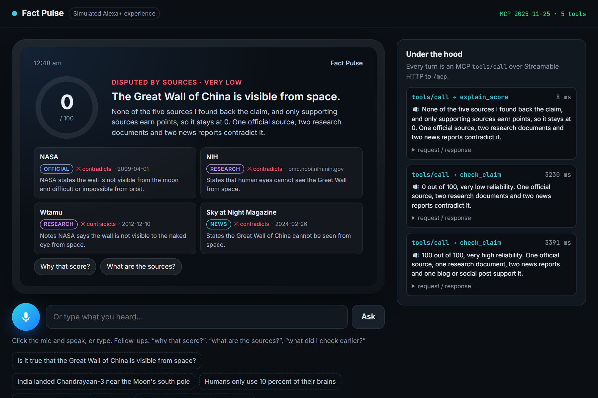

# Fact Pulse

**Ask Alexa+ whether something you heard is true, and get a score you can trust, out loud.**

> "Alexa, is it true that the Great Wall of China is visible from space?"
> "0 out of 100, very low reliability. One official source and two news reports contradict it."
> "Why that score?"
> "None of the three sources I found back the claim, and only supporting sources earn points, so it stays at 0…"



Fact Pulse is a **self-hosted MCP server (spec 2025-11-25, Streamable HTTP)** and a matching **Agent Skill** for the Alexa+ track of *Build, Ship, Shape*. It puts the [Veridex](https://getveridex.vercel.app) reliability engine behind a voice. Veridex scores claims 0–100 from sources people attach. Fact Pulse adds what voice needs: it **finds the sources itself**, labels them, and answers in two spoken sentences, with follow-ups.

A **simulated Alexa+ experience** (an Echo Show-style web app with real speech in and out) drives the MCP server over JSON-RPC and shows every tool call live.

## What's new in this hackathon

Veridex existed before the submission period (web app, REST API, six scoring rules). Everything in this repo was built during the hackathon:

| New | What it does |
|---|---|
| **Source discovery** (`src/discovery/`) | Searches the web for a spoken claim, then one Gemini call decides whether the claim is checkable and judges each result: *supports*, *contradicts* or *unrelated*. Each domain is then labelled *official*, *research document*, *news* or *blog/social*. |
| **Live-claim scoring** (`src/factCheck.js`) | Runs found sources through the Veridex rules, which are vendored unchanged in `src/scoring/evaluate.js`. Contradicting sources only subtract (see "Scoring decisions"). |
| **MCP server** (`src/mcp.js`) | 5 voice-first tools over Streamable HTTP. |
| **Agent Skill** (`skills/fact-pulse/SKILL.md`) | Tells any agent when to call which tool and how to speak the answer. |
| **Voice REST API** | `POST /api/voice/check` and its follow-ups, for non-MCP clients. |
| **Alexa+ simulator** (`public/`) | Mic in, speech out, result card, MCP trace. |
| **Veridex community link** | If someone already submitted a similar claim on Veridex, the card shows the community score. |

## MCP tools

| Tool | User says | Returns |
|---|---|---|
| `check_claim` | "Is it true that…", "I heard…" | score, verdict, top sources, `speech` (≤ 2 sentences) |
| `explain_score` | "Why that score?" | the rule breakdown as spoken sentences |
| `list_sources` | "What are the sources?" | publisher, type, stance, date, link |
| `check_status` | "Is it ready?" | result of a check that outran the voice time budget |
| `recent_checks` | "What did I check earlier?" | this listener's history, **across sessions** |

Every result has a `speech` string to read aloud plus `structuredContent` for a screen card. Follow-ups need no id: the server remembers each `listener`'s latest check. State is kept in the store, not in the MCP session, so "why that score?" still works in a new session or the next day.

## Run it

Requires Node 18+.

```bash
npm install
```

```bash
cp .env.example .env
```

In `.env`, set `GEMINI_API_KEY` (free at [aistudio.google.com](https://aistudio.google.com)) and `SERPER_API_KEY` (free at [serper.dev](https://serper.dev): 2,500 queries, no card).

```bash
npm start
```

- Simulator: http://localhost:3002 (voice input needs Chrome or Edge; typing works everywhere)
- Scripted demo: http://localhost:3002/?demo (click **▶ Start demo**; see [docs/DEMO-SCRIPT.md](docs/DEMO-SCRIPT.md))
- MCP endpoint: http://localhost:3002/mcp
- Health: http://localhost:3002/health

### Connect an MCP client

```json
{ "mcpServers": { "fact-pulse": { "type": "http", "url": "http://localhost:3002/mcp" } } }
```

Or use the MCP Inspector:

```bash
npx @modelcontextprotocol/inspector
```

Choose transport "Streamable HTTP" with URL `http://localhost:3002/mcp`.

### Tests

```bash
npm run test:unit
```

Offline tests of scoring, edge cases and spoken wording.

```bash
npm run test:mcp
```

Official MCP SDK client: connects, lists tools, runs a conversation.

```bash
npm run test:claims
```

Runs the 15 fixed claims live and writes latency and wording to `docs/test-run.md`.

## How a check works

```
"Alexa, is it true that…"                    ┌────────────── Fact Pulse ──────────────┐
        │                                     │ clean up ("Alexa", "is it true that")  │
        ▼                                     │ web search (Serper/Tavily/Brave)       │
 Alexa+ (simulated) ── MCP tools/call ──────▶ │ Gemini: checkable? stance per result   │
        ▲                                     │ label domains: official/doc/news/user  │
        │                                     │ Veridex rules → 0–100 + breakdown      │
        └──────── speech + card ◀──────────── │ speech (≤ 2 sentences) · history       │
                                              └──────┬────────────────────────┬────────┘
                                                     │ similar claim?         │
                                                     ▼                        ▼
                                            Veridex public API        data/checks.json
```

- **Time budget.** Voice can't wait 20 seconds. If a check runs past `VOICE_BUDGET_MS` (8 s), Fact Pulse answers *"I'm still checking… ask me 'is it ready?'"* and finishes in the background. The simulator updates the card when the result lands.
- **Caching.** Repeat claims are answered from a 6-hour cache.
- **Fallback.** `npm run test:claims -- --save` stores research snapshots, so the demo claims still score if the search or Gemini quota runs out. Results built from a snapshot are marked `mode: "snapshot"`.

## Scoring decisions

The six Veridex rules are reused **unchanged**. Using them on sources nobody attached needed four decisions:

1. **Only supporting sources earn points.** In Veridex, people attach sources to back a claim. Found sources can just as easily refute it, and three official sources contradicting a claim must not add 110 points. Supporting sources go through rules 1–4 and 6. Every source, for or against, goes through rule 5 (the AI evidence check), where each contradiction takes off 15.
2. **Unrelated search hits are dropped.** Veridex penalises an unrelated source a person attached. Here an unrelated hit is search noise, not a weakness of the claim.
3. **The moderator rule is skipped.** Found sources have no moderator review, so the rule adds nothing.
4. **No date, no freshness bonus.** A source earns the +10 recency bonus only if the search reports its publication date.

The **cap at 40** still applies. If only blogs and social posts back a claim, the answer says so: *"It's capped at 40 because I only found three blogs or social posts, with no official, research or news source."*

**Source types** come from fixed domain lists (`.gov`, `.nic.in`, `who.int` → official; `.edu`, `arxiv`, journals → research; established outlets and fact-checkers → news; Reddit, X, YouTube, Wikipedia, Medium → blog/social). Gemini can suggest a type for an unknown domain, but it can never make one *official*. Every cited source is an actual search result, so the model cannot invent a citation.

**Edge cases**

| Input | Answer |
|---|---|
| Opinion ("pineapple is the best topping") | Not scored. *"That sounds like an opinion…"* |
| Prediction ("India will win the next World Cup") | Not scored. *"…no source can confirm it yet."* |
| Vague ("they're hiding the truth") | Asks who, what and when. |
| Too short or several claims at once | Asks for one specific claim. |
| Nothing found | 0, and says so. |
| Search or Gemini down | *"I couldn't reach my sources just now, so I won't guess."* It never invents a score. |

## Configuration

See [`.env.example`](.env.example). `SEARCH_PROVIDER=gemini-grounding` switches to Gemini's built-in Google Search grounding, which needs a billed key. The free tier has a grounding quota of 0.

## Project layout

```
src/
  server.js            Express: /mcp, /api/voice/*, static simulator
  mcp.js               MCP server + 5 tools
  factCheck.js         pipeline, time budget, cache, snapshots, scoring glue
  speech.js            all spoken wording
  store.js             check history per listener
  veridexLookup.js     community score from the Veridex API
  scoring/evaluate.js  Veridex rules (vendored, unchanged)
  discovery/           search providers, Gemini judge, source classification
skills/fact-pulse/     Agent Skill (SKILL.md)
public/                simulated Alexa+ (Echo Show style) web app
scripts/               MCP smoke test, 15-claim test runner
test/                  offline unit tests
docs/                  test runs, product feedback, friction log
```

## License

MIT. See [LICENSE](LICENSE).
